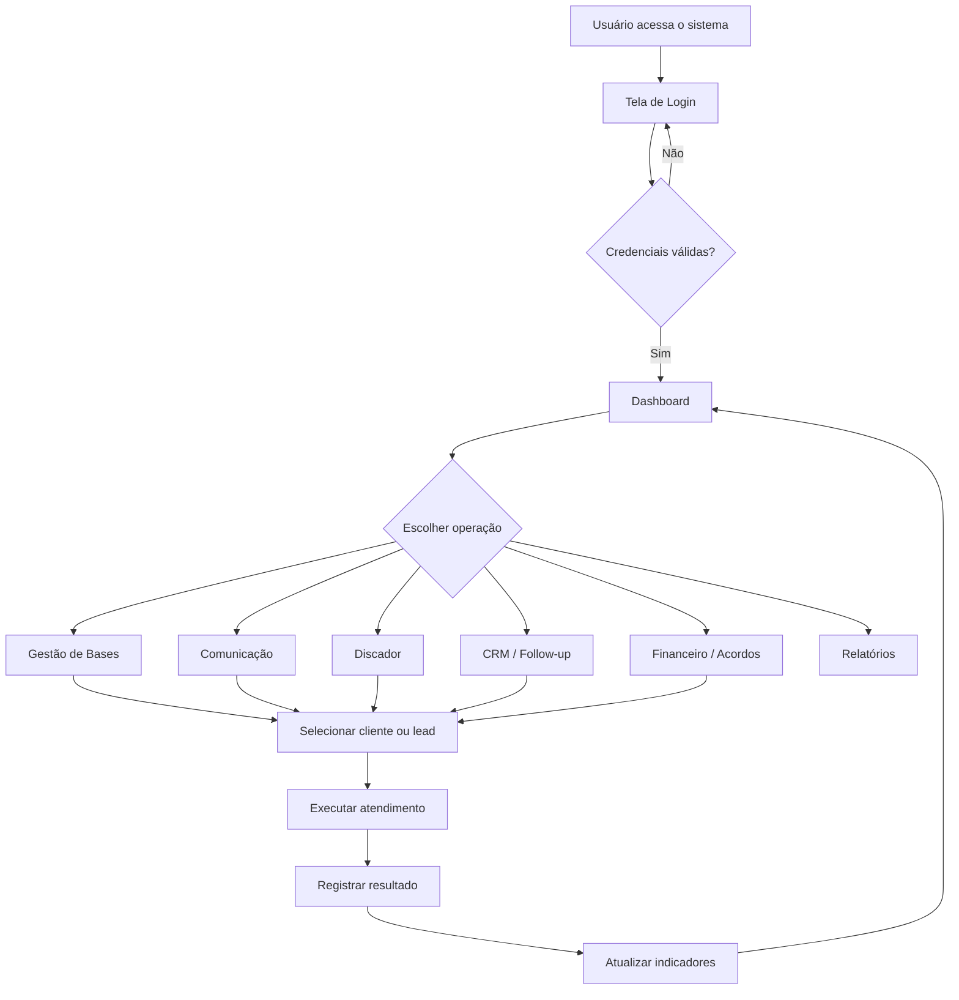
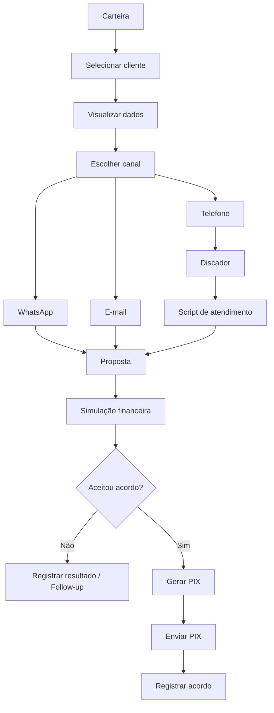
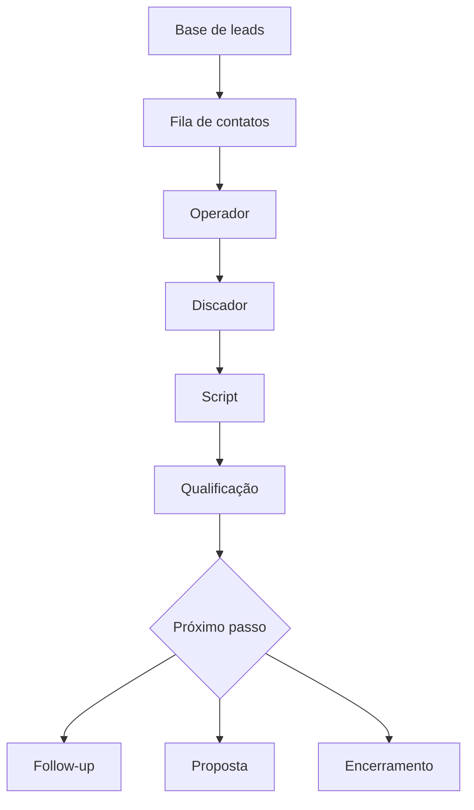
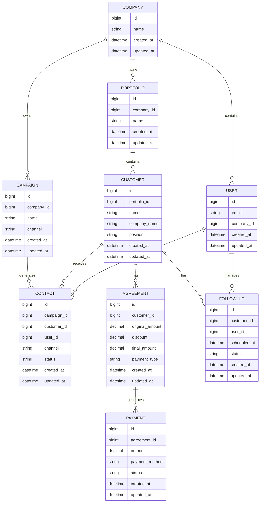

# PRD — HAZON CRM & Nation Dialer
## Product Requirements Document

**Versão:** 1.0  
**Data:** 7 de agosto de 2026  
**Status:** Base para desenvolvimento  
**Documento de referência:** PRD original do HAZON CRM & Nation Dialer fornecido para adaptação

---

# 1. Visão geral

O **HAZON CRM** e o **Nation Dialer** formam uma solução integrada para operações de cobrança, recuperação de inadimplência e prospecção de vendas *outbound*.

O sistema deverá centralizar em uma única aplicação:

- gestão de bases de clientes, leads e devedores;
- operações de cobrança e vendas *outbound*;
- campanhas multicanal;
- atendimento por WhatsApp;
- campanhas de e-mail;
- discagem telefônica integrada;
- scripts de atendimento;
- simulação de acordos financeiros;
- geração de PIX;
- acompanhamento de produtividade;
- dashboards de indicadores;
- gestão multiempresa.

A implementação deste PRD deverá utilizar **Python/Django no backend**, **Django REST Framework para a API REST**, **Django Templates (DTL) no frontend** e **TailwindCSS** para a interface.

O projeto deverá ser simples, enxuto, responsivo e consistente visualmente. Não deverão ser adicionadas funcionalidades que não estejam descritas neste documento.

---

# 2. Sobre o produto

O produto combina duas frentes operacionais:

1. **Cobrança e recuperação de inadimplência**
2. **Prospecção e vendas outbound**

A aplicação deverá permitir que o operador execute suas atividades diretamente no sistema, reduzindo a necessidade de alternar entre diferentes ferramentas.

Os principais módulos previstos são:

- Dashboard de KPIs;
- Gestão multiempresa;
- Gestão de bases;
- Central de comunicação;
- WhatsApp;
- E-mail;
- Discador;
- Scripts de atendimento;
- CRM/Kanban e follow-up;
- Simulação de acordos;
- Geração de PIX;
- Relatórios.

A referência funcional do produto indica uma interface moderna com **dark mode** e identidade corporativa. fileciteturn0file0

---

# 3. Propósito

O propósito do sistema é fornecer uma plataforma única para:

- organizar carteiras de clientes e devedores;
- executar operações de cobrança;
- realizar prospecção comercial;
- automatizar contatos;
- reduzir o tempo entre contatos telefônicos;
- disponibilizar informações do cliente ao operador;
- orientar o operador durante o atendimento;
- facilitar propostas e acordos;
- acompanhar resultados operacionais e financeiros.

---

# 4. Público-alvo

O produto deverá atender principalmente:

- empresas de cobrança;
- equipes de recuperação de crédito;
- operações de cobrança terceirizadas;
- equipes comerciais de vendas outbound;
- gestores de operações;
- administradores de empresas;
- operadores de cobrança;
- operadores comerciais.

---

# 5. Objetivos

## 5.1. Objetivos do produto

- Automatizar o acionamento de carteiras.
- Centralizar os canais de comunicação.
- Reduzir o tempo ocioso entre ligações.
- Disponibilizar scripts durante o atendimento.
- Facilitar a criação de acordos.
- Facilitar a geração e envio de PIX.
- Permitir acompanhamento gerencial em tempo real.
- Isolar os dados entre empresas.
- Manter uma interface consistente e responsiva.

## 5.2. Objetivos técnicos

- Utilizar Python e Django no backend.
- Disponibilizar API REST.
- Utilizar Django Templates no frontend.
- Utilizar TailwindCSS como padrão visual.
- Utilizar PostgreSQL como único banco de dados.
- Utilizar JWT para autenticação da API.
- Utilizar e-mail como identificador de login.
- Manter o código-fonte em inglês.
- Manter textos da interface em português brasileiro.
- Centralizar componentes e estilos.
- Priorizar segurança da informação.
- Manter todos os modelos com `created_at` e `updated_at`.
- Não utilizar Docker inicialmente.
- Não implementar testes inicialmente; testes deverão ser executados em sprint posterior.

---

# 6. Requisitos funcionais

## 6.1. Dashboard de KPIs

O sistema deverá apresentar um dashboard executivo com indicadores operacionais e financeiros.

### Indicadores

- Base em cobrança.
- Contatos úteis realizados (CPC).
- Retornos agendados.
- Acordos.
- Valores recuperados em R$.
- Produtividade individual dos operadores.

### Filtros

O dashboard deverá permitir filtros por:

- dia atual;
- últimos 7 dias;
- últimos 30 dias;
- mês corrente.

### Relatórios

O sistema deverá permitir a exportação dos relatórios gerenciais em:

- PDF;
- CSV.

---

## 6.2. Gestão multiempresa

O sistema deverá possuir segmentação por empresas.

Os dados operacionais deverão respeitar o contexto da empresa à qual pertencem.

A estrutura deverá permitir posteriormente a evolução para diferentes papéis e permissões.

Perfis já considerados no contexto do projeto:

- Administrador do SaaS;
- Administrador da Empresa.

---

## 6.3. Gestão de bases

O sistema deverá possuir estrutura para gerenciamento das bases utilizadas nas operações.

O escopo funcional da referência inclui:

- upload de CSV;
- listagem de clientes;
- dados cadastrais;
- carteiras;
- leads/devedores;
- informações utilizadas nas operações de cobrança e vendas.

A importação deverá preservar a separação dos dados por empresa.

---

## 6.4. Central de comunicação multicanal

A aplicação deverá centralizar os canais de comunicação utilizados pelo operador.

### WhatsApp

Deverá existir uma interface de atendimento com:

- visualização da conversa;
- envio de mensagens;
- utilização de mensagens padronizadas;
- contexto do cliente durante o atendimento.

Exemplos de templates citados na referência:

- Cobrança Amigável;
- Proposta com 35% de Desconto via PIX.

A integração deverá utilizar uma API de WhatsApp compatível com a operação definida pelo projeto.

### E-mail

O sistema deverá permitir:

- criação de campanhas;
- envio de campanhas;
- utilização de templates;
- acompanhamento de abertura;
- acompanhamento de cliques;
- acompanhamento de conversão de propostas.

---

## 6.5. Discador — Nation Dialer

O módulo de discagem deverá organizar os contatos telefônicos em filas.

A tela do operador deverá apresentar:

- nome;
- empresa;
- cargo;
- informações necessárias para o contato.

O sistema deverá permitir iniciar uma chamada com uma ação única, integrando-se ao softphone utilizado pela operação.

A referência do produto utiliza **MicroSIP** como exemplo de softphone. fileciteturn0file0

---

## 6.6. Scripts de atendimento

Durante uma chamada o operador deverá visualizar o roteiro correspondente à operação.

O roteiro deverá apoiar a condução da conversa.

A referência funcional utiliza **SPIN Selling** como exemplo de metodologia. fileciteturn0file0

---

## 6.7. CRM, Kanban e follow-up

O sistema deverá possuir estrutura para:

- organização de leads;
- qualificação;
- acompanhamento;
- follow-up;
- movimentação dos registros no funil;
- utilização de scripts de atendimento.

A interface deverá permitir a visualização do processo de forma organizada e compatível com operação comercial.

---

## 6.8. Simulação financeira

O operador deverá poder informar:

- valor original da dívida;
- modalidade de pagamento;
- regras de desconto aplicáveis.

O sistema deverá apresentar a simulação correspondente.

Deverão ser contempladas as condições citadas na referência:

- pagamento à vista;
- pagamento parcelado;
- descontos progressivos.

---

## 6.9. Geração de PIX

Após a definição de uma proposta, o sistema deverá permitir:

- geração do PIX;
- geração do QR Code;
- disponibilização do código para o operador;
- envio pelo canal de atendimento ativo.

A integração financeira deverá ser realizada por API compatível com o projeto.

---

## 6.10. Responsividade

Todas as telas deverão funcionar de forma adequada em diferentes tamanhos de tela.

A referência do produto considera como resolução corporativa mínima **1366x768**. fileciteturn0file0

---

## 6.11. Fluxos de UX

### Fluxo geral



### Fluxo de cobrança



### Fluxo de prospecção



---

# 7. Requisitos não funcionais

## 7.1. Segurança

- O sistema deverá priorizar segurança da informação.
- A autenticação da API deverá utilizar JWT.
- O login deverá utilizar e-mail.
- Os dados deverão ser isolados por empresa.
- As permissões deverão impedir acesso indevido entre empresas.
- Informações financeiras deverão ser protegidas.
- Credenciais e segredos não deverão ser armazenados diretamente no código.
- A aplicação deverá seguir boas práticas de segurança do Django.

## 7.2. Performance

As telas principais e dashboards deverão ter carregamento rápido.

A referência estabelece como critério de aceitação carregamento inferior a **1,5 segundo** para telas principais e dashboards, dentro das condições operacionais previstas. fileciteturn0file0

## 7.3. Responsividade

A interface deverá ser responsiva e adequada a ambientes corporativos.

## 7.4. Consistência visual

Todas as telas deverão utilizar os mesmos:

- componentes;
- espaçamentos;
- tipografia;
- botões;
- inputs;
- tabelas;
- menus;
- cards;
- estados visuais.

## 7.5. Internacionalização da interface

O código deverá ser escrito em inglês.

Todo conteúdo apresentado ao usuário deverá estar em **português brasileiro**.

Antes da conclusão de uma tela deverá ser realizada revisão visual e textual para evitar:

- erros de acentuação;
- erros de cedilha;
- erros de til;
- erros gramaticais;
- textos inconsistentes.

## 7.6. Banco de dados

O banco utilizado será exclusivamente:

**PostgreSQL**

Todos os modelos deverão possuir:

```text
created_at
updated_at
```

---

# 8. Arquitetura técnica

## 8.1. Stack

### Backend

- Python.
- Django.
- Django REST Framework.
- JWT.
- Django Templates / DTL.

### Frontend

- Django Templates.
- TailwindCSS.
- JavaScript somente quando necessário para comportamento da interface.

### Banco

- PostgreSQL.

### Comunicação

- API de WhatsApp.
- E-mail.
- Integração com telefonia/softphone.
- API financeira para PIX.

### Desenvolvimento

- Git.
- MCP Context7 para consulta de documentação técnica atualizada pelos agentes de implementação.
- MCP Playwright para validação funcional e visual pelos agentes de QA.

### Itens deliberadamente adiados

- Docker: somente em sprint final.
- Testes automatizados: somente em sprint final.

---

## 8.2. Organização de templates

Cada conjunto de templates deverá possuir seu próprio diretório, mantendo organização equivalente à separação dos módulos do backend.

A estrutura deverá favorecer:

- reutilização;
- componentes compartilhados;
- manutenção simples;
- consistência visual.

---

## 8.3. Estrutura de dados

A estrutura abaixo representa os principais conceitos funcionais derivados do PRD de referência.



O modelo é uma representação funcional inicial. Os modelos finais deverão ser derivados somente das funcionalidades efetivamente implementadas.

---

# 9. Design system

## 9.1. Princípio

Todo o sistema deverá possuir uma identidade visual única.

A referência funcional indica uma interface em **dark mode com acentos corporativos**. fileciteturn0file0

O TailwindCSS deverá ser utilizado como mecanismo principal de estilização.

Não deverão ser criados estilos isolados quando um componente ou classe reutilizável puder atender ao mesmo objetivo.

---

## 9.2. Cores

A interface deverá utilizar uma hierarquia visual baseada em:

- fundo principal escuro;
- superfícies/cards;
- bordas discretas;
- texto principal;
- texto secundário;
- cor corporativa de destaque;
- estados de sucesso;
- estados de alerta;
- estados de erro;
- estados informativos.

As cores deverão ser centralizadas na configuração do Tailwind sempre que possível.

Não deverão existir cores arbitrárias espalhadas pelos templates.

---

## 9.3. Botões

Deverão existir componentes padronizados para:

- ação primária;
- ação secundária;
- ação de sucesso;
- ação de alerta;
- ação destrutiva;
- botão somente com ícone.

Todos deverão manter:

- mesmo raio;
- mesma altura;
- mesmo padrão de espaçamento;
- estados `hover`;
- estado `focus`;
- estado `disabled`.

---

## 9.4. Inputs e formulários

Os campos deverão possuir:

- label;
- estado normal;
- foco;
- erro;
- ajuda contextual quando necessária;
- mensagens de validação.

Os formulários deverão manter o mesmo espaçamento e alinhamento em todas as telas.

---

## 9.5. Grids

As páginas deverão utilizar grid e flexbox do TailwindCSS.

Cards e blocos deverão respeitar uma mesma lógica de espaçamento.

---

## 9.6. Menus

O menu principal deverá possuir comportamento e aparência consistentes em todas as telas.

Deverá existir diferenciação visual entre:

- item ativo;
- item disponível;
- item desabilitado.

---

## 9.7. Tipografia

A tipografia deverá ser consistente em:

- títulos;
- subtítulos;
- labels;
- textos;
- tabelas;
- indicadores;
- mensagens;
- botões.

---

## 9.8. Componentização

Sempre que um elemento aparecer em mais de uma tela, deverá ser avaliada sua transformação em componente reutilizável.

Exemplos:

- navbar;
- sidebar;
- botão;
- input;
- modal;
- card;
- tabela;
- badge;
- alert;
- paginação;
- filtros;
- indicadores.

---

# 10. User stories

## Épico 1 — Dashboard

### História

**Como administrador da operação, quero visualizar os principais indicadores para acompanhar o desempenho da empresa.**

### Critérios de aceite

- [ ] O dashboard apresenta os indicadores definidos.
- [ ] É possível selecionar os períodos definidos.
- [ ] Os valores são apresentados em R$ quando aplicável.
- [ ] Os dados respeitam a empresa do usuário.
- [ ] A interface é responsiva.
- [ ] O dashboard segue o design system.

---

## Épico 2 — Base de clientes

### História

**Como operador, quero acessar a base de clientes para realizar os contatos da operação.**

### Critérios de aceite

- [ ] A base pode ser listada.
- [ ] O cliente pode ser selecionado.
- [ ] Os dados cadastrais são apresentados.
- [ ] Os registros respeitam a empresa.
- [ ] O operador consegue iniciar uma operação a partir do cliente.

---

## Épico 3 — Comunicação

### História

**Como operador, quero utilizar os canais de comunicação dentro do sistema para realizar o atendimento.**

### Critérios de aceite

- [ ] O cliente correto é apresentado.
- [ ] O canal selecionado é identificado.
- [ ] Mensagens podem ser enviadas conforme a integração disponível.
- [ ] Templates podem ser utilizados.
- [ ] O resultado do contato pode ser registrado.

---

## Épico 4 — Discador

### História

**Como operador, quero iniciar uma ligação diretamente da fila para reduzir o tempo entre contatos.**

### Critérios de aceite

- [ ] A fila apresenta os contatos.
- [ ] Os dados do contato ficam disponíveis.
- [ ] Existe ação para iniciar a chamada.
- [ ] O softphone pode ser acionado pela integração implementada.
- [ ] O resultado da chamada pode ser registrado.

---

## Épico 5 — Acordos

### História

**Como operador de cobrança, quero simular uma proposta para apresentar uma condição ao cliente.**

### Critérios de aceite

- [ ] O valor original pode ser informado.
- [ ] O desconto pode ser aplicado conforme regra configurada.
- [ ] O sistema apresenta o valor final.
- [ ] A modalidade de pagamento é identificada.
- [ ] Um acordo aceito pode seguir para geração do PIX.

---

## Épico 6 — PIX

### História

**Como operador, quero gerar um PIX para enviar ao cliente após a aceitação do acordo.**

### Critérios de aceite

- [ ] O acordo é identificado.
- [ ] O valor correto é utilizado.
- [ ] O PIX é gerado pela integração disponível.
- [ ] O QR Code é apresentado.
- [ ] O código pode ser utilizado pelo canal de atendimento.

---

# 11. Métricas de sucesso

## 11.1. KPIs de produto

- Tempo de carregamento das telas principais.
- Disponibilidade dos módulos.
- Taxa de utilização dos canais.
- Taxa de utilização do discador.
- Taxa de geração de acordos.
- Taxa de geração de PIX.

## 11.2. KPIs operacionais

- Número de contatos realizados.
- CPC.
- Número de retornos agendados.
- Número de acordos.
- Valor recuperado.
- Produtividade por operador.

## 11.3. KPIs comerciais

- Leads trabalhados.
- Leads qualificados.
- Follow-ups realizados.
- Propostas enviadas.
- Conversões.

---

# 12. Riscos e mitigações

| Risco | Mitigação |
|---|---|
| Vazamento entre empresas | Aplicar isolamento por empresa em consultas e regras de acesso |
| Falha de autenticação | Utilizar JWT e boas práticas de segurança do Django |
| Integração de WhatsApp indisponível | Isolar integração em camada própria |
| Integração telefônica indisponível | Isolar integração do softphone |
| Falha da API financeira | Isolar integração financeira e registrar estados das operações |
| Interface inconsistente | Centralizar componentes e TailwindCSS |
| Dados financeiros incorretos | Validar cálculos e estados das propostas |
| Performance insuficiente | Otimizar consultas e carregamento dos dashboards |
| Crescimento desorganizado do código | Manter separação entre módulos, templates e responsabilidades |
| Implementação de funcionalidades não previstas | Seguir estritamente este PRD |

---

# 13. Lista de tarefas

## Sprint 1 — Fundação e arquitetura

### 1.1. Estrutura inicial

- [ ] 1.1.1. Validar estrutura atual do projeto.
- [ ] 1.1.2. Confirmar Django como backend.
- [ ] 1.1.3. Confirmar Django REST Framework.
- [ ] 1.1.4. Confirmar PostgreSQL.
- [ ] 1.1.5. Confirmar Django Templates.
- [ ] 1.1.6. Confirmar TailwindCSS.
- [ ] 1.1.7. Documentar a estrutura existente.
- [ ] 1.1.8. Não adicionar Docker nesta sprint.

### 1.2. Configuração de segurança

- [ ] 1.2.1. Revisar configurações de segurança do Django.
- [ ] 1.2.2. Separar configurações sensíveis do código.
- [ ] 1.2.3. Configurar ambiente para PostgreSQL.
- [ ] 1.2.4. Validar configuração de JWT.
- [ ] 1.2.5. Validar autenticação por e-mail.

### 1.3. Base visual

- [ ] 1.3.1. Configurar TailwindCSS.
- [ ] 1.3.2. Definir tokens de cores.
- [ ] 1.3.3. Definir tipografia.
- [ ] 1.3.4. Definir espaçamentos.
- [ ] 1.3.5. Definir bordas e raios.
- [ ] 1.3.6. Criar layout base.
- [ ] 1.3.7. Criar estrutura de navegação.
- [ ] 1.3.8. Criar componentes visuais reutilizáveis.

---

# Sprint 2 — Multiempresa e usuários

## 2.1. Empresa

- [ ] 2.1.1. Criar/validar modelo de empresa.
- [ ] 2.1.2. Adicionar `created_at`.
- [ ] 2.1.3. Adicionar `updated_at`.
- [ ] 2.1.4. Criar relacionamento com usuários.
- [ ] 2.1.5. Criar relacionamento com dados operacionais.

## 2.2. Usuário

- [ ] 2.2.1. Validar usuário nativo do Django.
- [ ] 2.2.2. Validar login por e-mail.
- [ ] 2.2.3. Configurar JWT.
- [ ] 2.2.4. Validar sessão/autorização da API.
- [ ] 2.2.5. Validar associação usuário/empresa.

## 2.3. Isolamento

- [ ] 2.3.1. Definir regra de filtragem por empresa.
- [ ] 2.3.2. Aplicar filtragem aos endpoints.
- [ ] 2.3.3. Aplicar filtragem às páginas.
- [ ] 2.3.4. Validar tentativa de acesso cruzado.

---

# Sprint 3 — Gestão de bases

## 3.1. Carteiras

- [ ] 3.1.1. Criar estrutura de carteira.
- [ ] 3.1.2. Associar carteira à empresa.
- [ ] 3.1.3. Criar listagem.
- [ ] 3.1.4. Criar filtros necessários.
- [ ] 3.1.5. Criar tela de detalhe.

## 3.2. Clientes e leads

- [ ] 3.2.1. Criar estrutura de cliente.
- [ ] 3.2.2. Associar cliente à carteira.
- [ ] 3.2.3. Implementar listagem.
- [ ] 3.2.4. Implementar detalhe.
- [ ] 3.2.5. Exibir nome.
- [ ] 3.2.6. Exibir empresa.
- [ ] 3.2.7. Exibir cargo.
- [ ] 3.2.8. Exibir dados necessários à operação.

## 3.3. CSV

- [ ] 3.3.1. Implementar entrada de arquivo CSV.
- [ ] 3.3.2. Validar estrutura do arquivo.
- [ ] 3.3.3. Processar registros.
- [ ] 3.3.4. Associar registros à empresa.
- [ ] 3.3.5. Associar registros à carteira.
- [ ] 3.3.6. Informar erros de importação.

---

# Sprint 4 — Comunicação multicanal

## 4.1. Estrutura de campanhas

- [ ] 4.1.1. Criar estrutura de campanha.
- [ ] 4.1.2. Associar campanha à empresa.
- [ ] 4.1.3. Definir canal.
- [ ] 4.1.4. Criar listagem.
- [ ] 4.1.5. Criar detalhe.

## 4.2. WhatsApp

- [ ] 4.2.1. Criar camada de integração.
- [ ] 4.2.2. Criar interface de conversa.
- [ ] 4.2.3. Exibir cliente no contexto da conversa.
- [ ] 4.2.4. Implementar envio.
- [ ] 4.2.5. Implementar templates.
- [ ] 4.2.6. Registrar resultado do contato.

## 4.3. E-mail

- [ ] 4.3.1. Criar estrutura de campanha de e-mail.
- [ ] 4.3.2. Criar template.
- [ ] 4.3.3. Implementar envio.
- [ ] 4.3.4. Registrar abertura quando suportado.
- [ ] 4.3.5. Registrar cliques quando suportado.
- [ ] 4.3.6. Registrar conversões quando suportado.

---

# Sprint 5 — Nation Dialer

## 5.1. Fila

- [ ] 5.1.1. Criar estrutura de fila.
- [ ] 5.1.2. Associar contatos.
- [ ] 5.1.3. Ordenar contatos.
- [ ] 5.1.4. Exibir dados do contato.
- [ ] 5.1.5. Criar tela do operador.

## 5.2. Softphone

- [ ] 5.2.1. Criar camada de integração.
- [ ] 5.2.2. Implementar ação de chamada.
- [ ] 5.2.3. Integrar com softphone compatível.
- [ ] 5.2.4. Validar fluxo com MicroSIP quando utilizado pela operação.
- [ ] 5.2.5. Registrar resultado da chamada.

## 5.3. Script

- [ ] 5.3.1. Criar estrutura de script.
- [ ] 5.3.2. Associar script à operação.
- [ ] 5.3.3. Exibir script durante a chamada.
- [ ] 5.3.4. Validar visualização sem prejudicar o fluxo do operador.

---

# Sprint 6 — CRM, follow-up e acordos

## 6.1. CRM

- [ ] 6.1.1. Criar estrutura do funil.
- [ ] 6.1.2. Criar visualização Kanban.
- [ ] 6.1.3. Implementar movimentação dos registros.
- [ ] 6.1.4. Registrar alterações.
- [ ] 6.1.5. Manter contexto da empresa.

## 6.2. Follow-up

- [ ] 6.2.1. Criar estrutura de follow-up.
- [ ] 6.2.2. Associar follow-up ao cliente.
- [ ] 6.2.3. Associar responsável.
- [ ] 6.2.4. Registrar data.
- [ ] 6.2.5. Registrar status.
- [ ] 6.2.6. Exibir follow-ups pendentes.

## 6.3. Simulador financeiro

- [ ] 6.3.1. Criar formulário de simulação.
- [ ] 6.3.2. Receber valor original.
- [ ] 6.3.3. Aplicar desconto.
- [ ] 6.3.4. Calcular valor final.
- [ ] 6.3.5. Diferenciar pagamento à vista.
- [ ] 6.3.6. Diferenciar pagamento parcelado.
- [ ] 6.3.7. Exibir resultado.
- [ ] 6.3.8. Registrar acordo aceito.

## 6.4. PIX

- [ ] 6.4.1. Criar camada de integração financeira.
- [ ] 6.4.2. Receber dados do acordo.
- [ ] 6.4.3. Solicitar geração do PIX.
- [ ] 6.4.4. Receber código PIX.
- [ ] 6.4.5. Receber QR Code quando disponível.
- [ ] 6.4.6. Exibir PIX ao operador.
- [ ] 6.4.7. Permitir utilização pelo canal de atendimento.
- [ ] 6.4.8. Registrar estado da operação.

---

# Sprint 7 — Dashboard e relatórios

## 7.1. Indicadores

- [x] 7.1.1. Implementar indicador de base.
- [x] 7.1.2. Implementar CPC.
- [x] 7.1.3. Implementar retornos.
- [x] 7.1.4. Implementar acordos.
- [x] 7.1.5. Implementar valor recuperado.
- [x] 7.1.6. Implementar produtividade.

## 7.2. Filtros

- [x] 7.2.1. Implementar filtro do dia.
- [x] 7.2.2. Implementar últimos 7 dias.
- [x] 7.2.3. Implementar últimos 30 dias.
- [x] 7.2.4. Implementar mês corrente.

## 7.3. Exportação

- [x] 7.3.1. Implementar exportação CSV.
- [x] 7.3.2. Implementar exportação PDF.
- [x] 7.3.3. Validar dados exportados.
- [x] 7.3.4. Respeitar empresa e permissões.

---

# Sprint 8 — Revisão de interface e segurança

## 8.1. Design system

- [x] 8.1.1. Revisar todas as páginas. (auditoria: botões antigos mapeados e migrados)
- [x] 8.1.2. Padronizar botões. (todos os internos em hazon-btn-primary/danger)
- [ ] 8.1.3. Padronizar inputs.
- [ ] 8.1.4. Padronizar formulários.
- [ ] 8.1.5. Padronizar cards.
- [ ] 8.1.6. Padronizar tabelas.
- [ ] 8.1.7. Padronizar menus.
- [ ] 8.1.8. Revisar responsividade.

## 8.2. Conteúdo

- [x] 8.2.1. Revisar todos os textos. (varredura PT-BR limpa; placeholders de e-mail intencionais)
- [ ] 8.2.2. Corrigir acentos.
- [ ] 8.2.3. Corrigir cedilha.
- [ ] 8.2.4. Corrigir til.
- [ ] 8.2.5. Corrigir erros gramaticais.
- [ ] 8.2.6. Garantir português brasileiro.

## 8.3. Segurança

- [x] 8.3.1. Revisar autenticação. (bug corrigido: campos personalizados exigiam só admin, sem login)
- [x] 8.3.2. Revisar autorização. (decorators confirmados; operacional/viewer restritos)
- [x] 8.3.3. Revisar isolamento por empresa. (filtro_tenant confirmado nas rotas)
- [x] 8.3.4. Revisar exposição de dados. (listagem de sessões filtra expiradas)
- [x] 8.3.5. Revisar variáveis sensíveis. (.env no gitignore; ALLOWED_HOSTS configurável)
- [x] 8.3.6. Revisar endpoints. (auditoria de rotas; públicas intencionais confirmadas)

---

# Sprint 9 — Documentação

## 9.1. Pasta DOCS

Criar:

```text
DOCS/
├── README.md
├── architecture.md
├── backend.md
├── frontend.md
├── database.md
├── security.md
├── design-system.md
├── api.md
└── development-guidelines.md
```

A documentação deverá descrever somente o que efetivamente existir no projeto no momento da documentação.

### Tarefas

- [x] 9.1.1. Criar `DOCS/`. (pasta com os 9 arquivos + PRD e caderno)
- [x] 9.1.2. Criar `DOCS/README.md`. (índice da documentação)
- [x] 9.1.3. Documentar arquitetura existente. (`architecture.md` — camadas, portas, apps, multi-tenant)
- [x] 9.1.4. Documentar backend existente. (`backend.md` — apps, modelos, views, comandos, serviços)
- [x] 9.1.5. Documentar frontend/DTL existente. (`frontend.md` — templates, base, telas, SVG)
- [x] 9.1.6. Documentar banco existente. (`database.md` — tabelas por app, multi-tenant, índices)
- [x] 9.1.7. Documentar segurança existente. (`security.md` — auth, RBAC, headers, CSP, segredos)
- [x] 9.1.8. Documentar design system existente. (`design-system.md` — tokens e componentes hazon-*)
- [x] 9.1.9. Documentar API existente. (`api.md` — autenticação, rotas e padrões da API v1)
- [x] 9.1.10. Documentar guidelines de desenvolvimento. (`development-guidelines.md`)
- [x] 9.1.11. Não documentar funcionalidades inexistentes. (descrição limitada ao que existe no código)

---

# Sprint 10 — Agentes de IA

## 10.1. Estrutura

Criar:

```text
app/
└── agentes/
    ├── README.md
    ├── django.md
    ├── drf-api.md
    ├── django-templates-tailwind.md
    ├── postgresql.md
    ├── integrations.md
    └── qa-playwright.md
```

Somente agentes necessários para produção e validação do software deverão ser criados.

## 10.2. Agente Django

- [ ] 10.2.1. Criar especialista em Django.
- [ ] 10.2.2. Definir responsabilidades.
- [ ] 10.2.3. Definir padrões de implementação.
- [ ] 10.2.4. Orientar consulta ao Context7.
- [ ] 10.2.5. Restringir implementação ao escopo do PRD.

## 10.3. Agente DRF/API

- [ ] 10.3.1. Criar especialista em Django REST Framework.
- [ ] 10.3.2. Definir padrões de endpoints.
- [ ] 10.3.3. Definir padrões de autenticação JWT.
- [ ] 10.3.4. Definir validação de dados.
- [ ] 10.3.5. Orientar uso do Context7.

## 10.4. Agente DTL/TailwindCSS

- [ ] 10.4.1. Criar especialista em Django Templates.
- [ ] 10.4.2. Criar especialista em TailwindCSS dentro do mesmo agente.
- [ ] 10.4.3. Definir uso de componentes.
- [ ] 10.4.4. Definir responsividade.
- [ ] 10.4.5. Definir identidade visual.
- [ ] 10.4.6. Orientar consulta ao Context7.

## 10.5. Agente PostgreSQL

- [ ] 10.5.1. Criar especialista em PostgreSQL.
- [ ] 10.5.2. Definir padrões de modelagem.
- [ ] 10.5.3. Validar índices quando necessários.
- [ ] 10.5.4. Validar relacionamentos.
- [ ] 10.5.5. Garantir `created_at` e `updated_at`.
- [ ] 10.5.6. Orientar consulta ao Context7.

## 10.6. Agente de integrações

- [ ] 10.6.1. Criar especialista em integrações.
- [ ] 10.6.2. Separar integrações externas do domínio principal.
- [ ] 10.6.3. Trabalhar com WhatsApp.
- [ ] 10.6.4. Trabalhar com e-mail.
- [ ] 10.6.5. Trabalhar com telefonia.
- [ ] 10.6.6. Trabalhar com API financeira/PIX.
- [ ] 10.6.7. Utilizar Context7 para documentação atualizada.

## 10.7. Agente QA

- [ ] 10.7.1. Criar agente de QA.
- [ ] 10.7.2. Utilizar MCP Playwright.
- [ ] 10.7.3. Acessar o sistema.
- [ ] 10.7.4. Validar fluxos funcionais.
- [ ] 10.7.5. Validar responsividade.
- [ ] 10.7.6. Validar design system.
- [ ] 10.7.7. Validar textos apresentados ao usuário.
- [ ] 10.7.8. Registrar falhas encontradas.

## 10.8. README dos agentes

- [ ] 10.8.1. Criar `app/agentes/README.md`.
- [ ] 10.8.2. Listar cada agente.
- [ ] 10.8.3. Descrever responsabilidade.
- [ ] 10.8.4. Descrever quando utilizar.
- [ ] 10.8.5. Informar quais agentes utilizam Context7.
- [ ] 10.8.6. Informar que o agente QA utiliza Playwright.

---

# Sprint 11 — Docker e testes

Docker e testes não deverão ser implementados nas primeiras etapas.

## 11.1. Docker

- [ ] 11.1.1. Avaliar requisitos finais de containerização.
- [ ] 11.1.2. Criar Dockerfile.
- [ ] 11.1.3. Criar configuração de execução.
- [ ] 11.1.4. Validar aplicação em container.
- [ ] 11.1.5. Validar PostgreSQL em ambiente containerizado.

## 11.2. Testes

- [ ] 11.2.1. Definir estratégia de testes.
- [ ] 11.2.2. Criar testes unitários necessários.
- [ ] 11.2.3. Criar testes de API.
- [ ] 11.2.4. Criar testes dos fluxos principais.
- [ ] 11.2.5. Executar testes com Playwright.
- [ ] 11.2.6. Corrigir falhas.
- [ ] 11.2.7. Executar regressão final.

---

# 14. Regras gerais de desenvolvimento

1. O código deve ser escrito em inglês.
2. Utilizar aspas simples sempre que possível.
3. A interface deve ser escrita em português brasileiro.
4. Todo texto da interface deve passar por revisão gramatical.
5. Utilizar PostgreSQL exclusivamente.
6. Todo modelo/tabela deverá possuir `created_at` e `updated_at`.
7. Utilizar Django Templates para o frontend.
8. Utilizar TailwindCSS para estilização.
9. Centralizar estilos e componentes sempre que possível.
10. Manter identidade visual única.
11. Priorizar responsividade.
12. Priorizar segurança da informação.
13. Não adicionar funcionalidades não descritas no PRD.
14. Não implementar Docker antes da sprint definida.
15. Não implementar testes antes da sprint definida.
16. Utilizar Context7 nos agentes responsáveis por implementação técnica.
17. Utilizar Playwright no agente de QA.
18. A documentação deverá representar somente o que existe no projeto.
19. A implementação deverá ser incremental e seguir a ordem das sprints.
20. Toda nova implementação deverá respeitar o isolamento multiempresa.

---

# 15. Critérios finais de aceitação

O projeto será considerado aderente a este PRD quando:

- [ ] A aplicação utilizar Python/Django.
- [ ] A API REST estiver implementada com Django REST Framework.
- [ ] A autenticação utilizar JWT.
- [ ] O login utilizar e-mail.
- [ ] O banco utilizado for PostgreSQL.
- [ ] Os modelos possuírem `created_at` e `updated_at`.
- [ ] O frontend utilizar Django Templates.
- [ ] O TailwindCSS estiver centralizado e padronizado.
- [ ] A interface estiver em português brasileiro.
- [ ] O código estiver em inglês.
- [ ] O sistema possuir isolamento por empresa.
- [ ] O dashboard apresentar os KPIs previstos.
- [ ] A gestão de bases estiver disponível.
- [ ] A comunicação multicanal estiver estruturada.
- [ ] O módulo de discagem estiver estruturado.
- [ ] Os scripts de atendimento estiverem disponíveis.
- [ ] O CRM/follow-up estiver implementado.
- [ ] O simulador de acordos estiver implementado.
- [ ] A geração de PIX estiver integrada.
- [ ] Os relatórios previstos estiverem disponíveis.
- [ ] A interface for responsiva.
- [ ] A documentação estiver em `DOCS/`.
- [ ] Os agentes estiverem em `app/agentes/`.
- [ ] Docker e testes somente sejam introduzidos na etapa prevista.
- [ ] O sistema não contenha funcionalidades fora do escopo deste PRD.

---

# 16. Referência funcional

Este PRD foi adaptado a partir do documento de requisitos do **HAZON CRM & Nation Dialer** fornecido como referência. A referência original descreve o produto como uma solução integrada de cobrança, recuperação de inadimplência e prospecção outbound, com dashboards, gestão de bases, comunicação por WhatsApp/e-mail, discador, scripts, CRM, acordos financeiros e PIX. fileciteturn0file0

A adaptação tecnológica deste documento substitui a arquitetura originalmente indicada na referência por:

- Python;
- Django;
- Django REST Framework;
- JWT;
- Django Templates;
- TailwindCSS;
- PostgreSQL.

As funcionalidades de produto foram preservadas dentro do escopo descrito na referência e reorganizadas conforme as regras de desenvolvimento solicitadas.
